R for data science: Assignment 1
================
Moise Tuyizere
2026-10-31

## Introduction

This assignment shows how to install packages in R, import data from
different sources, and use the packages to describe the data. Each
dataset is explored with the tools from class: `head()`, `str()`,
`summary()`, `by()`, `xtabs()`, `boxplot()`, `plot()`, `hist()` and
`merge()`.

## Location of the data

All data files are saved in one folder. The code below tells R where
that folder is, so each file can be read by its name. If you download
this project from GitHub, change the path to the folder where you saved
it.

``` r
data_folder <- "C:/Users/smartsource ltd/Downloads/Assignment1"
setwd(data_folder)                           
knitr::opts_knit$set(root.dir = data_folder) 
```

``` r
list.files()
```

    ##  [1] "Assignment1.md"      "Assignment1.Rmd"     "Assignment1_files"  
    ##  [4] "procurement.sqlite"  "purchase_orders.csv" "staff_survey.dta"   
    ##  [7] "staff_survey.sav"    "staff_survey.xpt"    "store_stock.xlsx"   
    ## [10] "students.txt"

| File                | Source            | Package      |
|---------------------|-------------------|--------------|
| students.txt        | Text file         | base R       |
| purchase_orders.csv | CSV file          | base R       |
| store_stock.xlsx    | Excel             | readxl       |
| staff_survey.sav    | SPSS              | haven        |
| staff_survey.dta    | Stata             | haven        |
| staff_survey.xpt    | SAS               | haven        |
| procurement.sqlite  | Database (SQLite) | DBI, RSQLite |

## Installation of packages

A package is installed once, then loaded with `library()` every time.

``` r
install.packages("readxl")    # Excel files
install.packages("haven")     # SPSS, Stata and SAS files
install.packages("DBI")       # connecting to databases
install.packages("RSQLite")   # SQLite database
```

``` r
library(readxl)
library(haven)
library(DBI)
library(RSQLite)
```

## 1. Data from a text file

``` r
students <- read.table("students.txt", header = TRUE)
head(students)
```

    ##   ID GENDER HEIGHT WEIGHT
    ## 1  1      M    156     50
    ## 2  2      M    162     52
    ## 3  3      M    168     44
    ## 4  4      F    162     56
    ## 5  5      F    156     49
    ## 6  6      F    150     53

``` r
str(students)
```

    ## 'data.frame':    30 obs. of  4 variables:
    ##  $ ID    : int  1 2 3 4 5 6 7 8 9 10 ...
    ##  $ GENDER: chr  "M" "M" "M" "F" ...
    ##  $ HEIGHT: int  156 162 168 162 156 150 161 166 167 161 ...
    ##  $ WEIGHT: int  50 52 44 56 49 53 60 51 64 52 ...

``` r
summary(students)
```

    ##        ID              GENDER       HEIGHT          WEIGHT     
    ##  Min.   : 1.00   Length   :30   Min.   :149.0   Min.   :44.00  
    ##  1st Qu.: 8.25   N.unique : 2   1st Qu.:156.0   1st Qu.:48.25  
    ##  Median :15.50   N.blank  : 0   Median :161.5   Median :50.50  
    ##  Mean   :15.50   Min.nchar: 1   Mean   :160.5   Mean   :51.60  
    ##  3rd Qu.:22.75   Max.nchar: 1   3rd Qu.:163.8   3rd Qu.:54.75  
    ##  Max.   :30.00                  Max.   :178.0   Max.   :64.00

Mean height by gender:

``` r
by(students$HEIGHT, students$GENDER, mean)
```

    ## students$GENDER: F
    ## [1] 158.3571
    ## ------------------------------------------------------------ 
    ## students$GENDER: M
    ## [1] 162.3125

``` r
xtabs(~ GENDER, data = students)
```

    ## GENDER
    ##  F  M 
    ## 14 16

``` r
boxplot(HEIGHT ~ GENDER, data = students, main = "Height by gender")
```

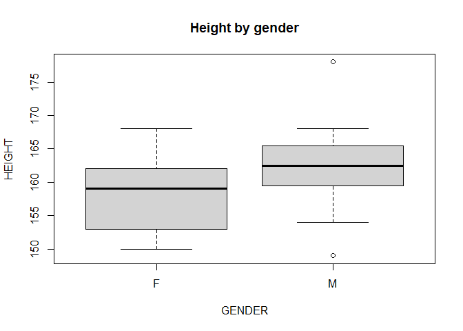<!-- -->

Relationship between height and weight:

``` r
plot(WEIGHT ~ HEIGHT, data = students, main = "Weight and height")
abline(lm(WEIGHT ~ HEIGHT, data = students)$coefficient)
```

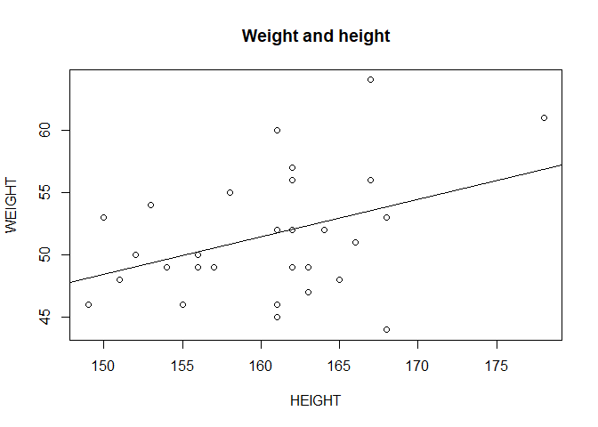<!-- -->

``` r
cor(students$HEIGHT, students$WEIGHT)
```

    ## [1] 0.3870598

``` r
hist(students$HEIGHT, col = "blue", main = "Height of students", xlab = "Height (cm)")
```

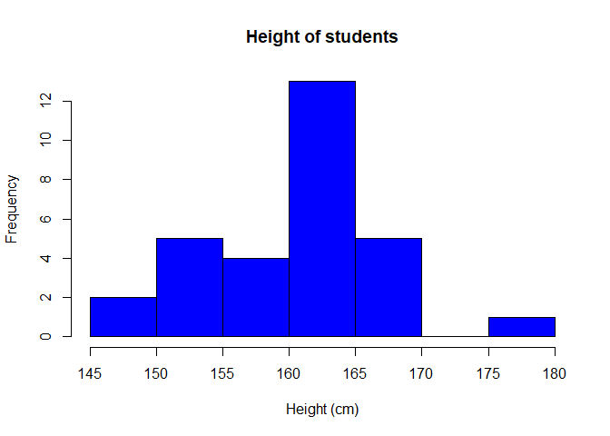<!-- -->

## 2. Data from a CSV file

``` r
orders <- read.csv("purchase_orders.csv")
head(orders)
```

    ##   PO_ID               SUPPLIER     CATEGORY QUANTITY UNIT_PRICE DELIVERY_DAYS
    ## 1 PO001 Kigali Office Supplies   Stationery       98      42600             3
    ## 2 PO002        Ubumwe Catering     Catering       28      18900             7
    ## 3 PO003 Kigali Office Supplies   Stationery       26      20600             3
    ## 4 PO004        Rwanda Tech Ltd IT Equipment       93      41400             3
    ## 5 PO005        Rwanda Tech Ltd IT Equipment       80      44700            NA
    ## 6 PO006             Clean Plus     Cleaning       58      42100             4

``` r
str(orders)
```

    ## 'data.frame':    40 obs. of  6 variables:
    ##  $ PO_ID        : chr  "PO001" "PO002" "PO003" "PO004" ...
    ##  $ SUPPLIER     : chr  "Kigali Office Supplies" "Ubumwe Catering" "Kigali Office Supplies" "Rwanda Tech Ltd" ...
    ##  $ CATEGORY     : chr  "Stationery" "Catering" "Stationery" "IT Equipment" ...
    ##  $ QUANTITY     : int  98 28 26 93 80 58 100 12 87 66 ...
    ##  $ UNIT_PRICE   : int  42600 18900 20600 41400 44700 42100 24200 48200 30500 37100 ...
    ##  $ DELIVERY_DAYS: int  3 7 3 3 NA 4 11 10 13 4 ...

``` r
summary(orders)
```

    ##        PO_ID         SUPPLIER       CATEGORY     QUANTITY        UNIT_PRICE   
    ##  Length   :40   Length   :40   Length   :40   Min.   : 12.00   Min.   : 3100  
    ##  N.unique :40   N.unique : 4   N.unique : 4   1st Qu.: 33.00   1st Qu.:20575  
    ##  N.blank  : 0   N.blank  : 0   N.blank  : 0   Median : 62.00   Median :32050  
    ##  Min.nchar: 5   Min.nchar:10   Min.nchar: 8   Mean   : 56.92   Mean   :29748  
    ##  Max.nchar: 5   Max.nchar:22   Max.nchar:12   3rd Qu.: 78.50   3rd Qu.:40650  
    ##                                               Max.   :100.00   Max.   :48200  
    ##                                                                               
    ##  DELIVERY_DAYS   
    ##  Min.   : 2.000  
    ##  1st Qu.: 4.250  
    ##  Median : 7.000  
    ##  Mean   : 7.211  
    ##  3rd Qu.:10.000  
    ##  Max.   :13.000  
    ##  NAs    :2

The CSV file has missing values in delivery days:

``` r
is.na(orders$DELIVERY_DAYS)
```

    ##  [1] FALSE FALSE FALSE FALSE  TRUE FALSE FALSE FALSE FALSE FALSE FALSE FALSE
    ## [13] FALSE FALSE FALSE FALSE FALSE  TRUE FALSE FALSE FALSE FALSE FALSE FALSE
    ## [25] FALSE FALSE FALSE FALSE FALSE FALSE FALSE FALSE FALSE FALSE FALSE FALSE
    ## [37] FALSE FALSE FALSE FALSE

``` r
mean(orders$DELIVERY_DAYS, na.rm = TRUE)
```

    ## [1] 7.210526

Creating a new variable, total cost:

``` r
orders$TOTAL_COST <- orders$QUANTITY * orders$UNIT_PRICE
head(orders[, c("PO_ID", "QUANTITY", "UNIT_PRICE", "TOTAL_COST")])
```

    ##   PO_ID QUANTITY UNIT_PRICE TOTAL_COST
    ## 1 PO001       98      42600    4174800
    ## 2 PO002       28      18900     529200
    ## 3 PO003       26      20600     535600
    ## 4 PO004       93      41400    3850200
    ## 5 PO005       80      44700    3576000
    ## 6 PO006       58      42100    2441800

``` r
by(orders$DELIVERY_DAYS, orders$CATEGORY, mean, na.rm = TRUE)
```

    ## orders$CATEGORY: Catering
    ## [1] 8.875
    ## ------------------------------------------------------------ 
    ## orders$CATEGORY: Cleaning
    ## [1] 7.666667
    ## ------------------------------------------------------------ 
    ## orders$CATEGORY: IT Equipment
    ## [1] 6.333333
    ## ------------------------------------------------------------ 
    ## orders$CATEGORY: Stationery
    ## [1] 6.444444

``` r
xtabs(TOTAL_COST ~ CATEGORY, data = orders)
```

    ## CATEGORY
    ##     Catering     Cleaning IT Equipment   Stationery 
    ##     10529800     14932700     28593700     13999900

``` r
boxplot(DELIVERY_DAYS ~ CATEGORY, data = orders, main = "Delivery days by category")
```

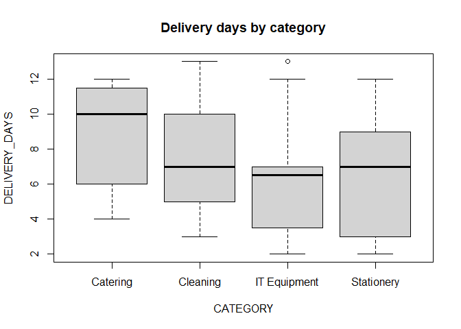<!-- -->

``` r
plot(TOTAL_COST ~ QUANTITY, data = orders, main = "Total cost and quantity")
```

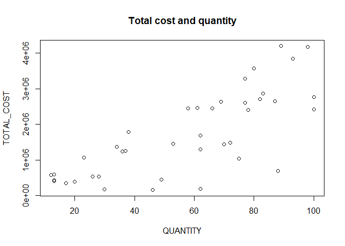<!-- -->

``` r
hist(orders$UNIT_PRICE, col = "blue", main = "Unit price", xlab = "RWF")
```

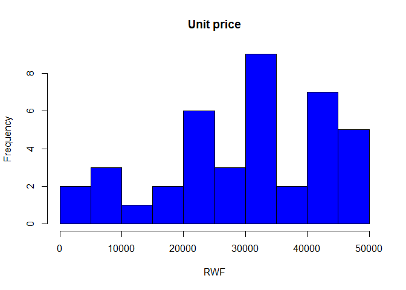<!-- -->

## 3. Data from Excel

The `readxl` package reads Excel files directly.

``` r
excel_sheets("store_stock.xlsx")
```

    ## [1] "Sheet1"

``` r
stock <- read_excel("store_stock.xlsx")
head(stock)
```

    ## # A tibble: 6 × 4
    ##   ITEM      CATEGORY   STOCK REORDER_LEVEL
    ##   <chr>     <chr>      <dbl>         <dbl>
    ## 1 A4 paper  Stationery    45            20
    ## 2 Toner     Stationery     6            10
    ## 3 Pens      Stationery   120            50
    ## 4 Folders   Stationery    30            15
    ## 5 Hand soap Cleaning      12             8
    ## 6 Detergent Cleaning       3             6

``` r
str(stock)
```

    ## tibble [10 × 4] (S3: tbl_df/tbl/data.frame)
    ##  $ ITEM         : chr [1:10] "A4 paper" "Toner" "Pens" "Folders" ...
    ##  $ CATEGORY     : chr [1:10] "Stationery" "Stationery" "Stationery" "Stationery" ...
    ##  $ STOCK        : num [1:10] 45 6 120 30 12 3 40 18 9 4
    ##  $ REORDER_LEVEL: num [1:10] 20 10 50 15 8 6 20 5 5 5

``` r
summary(stock)
```

    ##         ITEM         CATEGORY      STOCK        REORDER_LEVEL  
    ##  Length   :10   Length   :10   Min.   :  3.00   Min.   : 5.00  
    ##  N.unique :10   N.unique : 3   1st Qu.:  6.75   1st Qu.: 5.25  
    ##  N.blank  : 0   N.blank  : 0   Median : 15.00   Median : 9.00  
    ##  Min.nchar: 4   Min.nchar: 8   Mean   : 28.70   Mean   :14.40  
    ##  Max.nchar: 9   Max.nchar:12   3rd Qu.: 37.50   3rd Qu.:18.75  
    ##                                Max.   :120.00   Max.   :50.00

``` r
by(stock$STOCK, stock$CATEGORY, sum)
```

    ## stock$CATEGORY: Cleaning
    ## [1] 55
    ## ------------------------------------------------------------ 
    ## stock$CATEGORY: IT Equipment
    ## [1] 31
    ## ------------------------------------------------------------ 
    ## stock$CATEGORY: Stationery
    ## [1] 201

``` r
xtabs(STOCK ~ CATEGORY, data = stock)
```

    ## CATEGORY
    ##     Cleaning IT Equipment   Stationery 
    ##           55           31          201

``` r
boxplot(STOCK ~ CATEGORY, data = stock, main = "Stock by category")
```

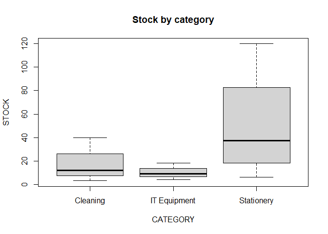<!-- -->

``` r
plot(STOCK ~ REORDER_LEVEL, data = stock, main = "Stock and reorder level")
abline(0, 1, col = "red")   # items below the red line need reordering
```

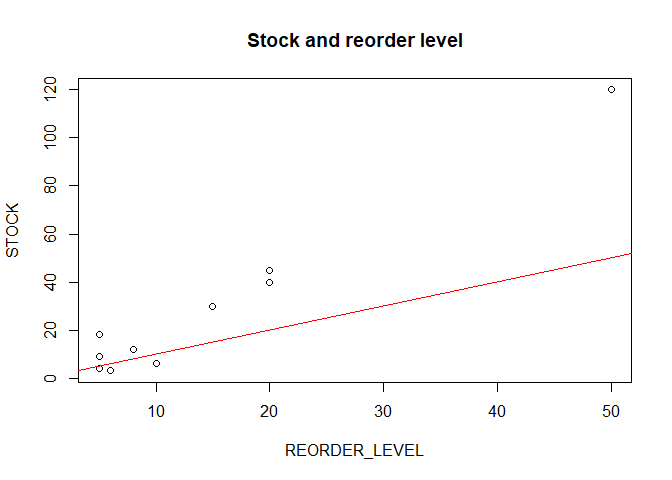<!-- -->

``` r
hist(stock$STOCK, col = "blue", main = "Stock quantity", xlab = "Units")
```

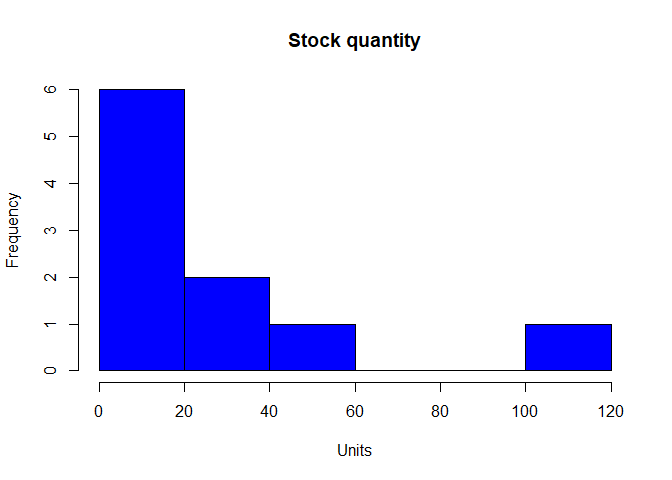<!-- -->

Items below their reorder level:

``` r
stock[stock$STOCK <= stock$REORDER_LEVEL, ]
```

    ## # A tibble: 3 × 4
    ##   ITEM      CATEGORY     STOCK REORDER_LEVEL
    ##   <chr>     <chr>        <dbl>         <dbl>
    ## 1 Toner     Stationery       6            10
    ## 2 Detergent Cleaning         3             6
    ## 3 Keyboard  IT Equipment     4             5

## 4. Data from SPSS

The `haven` package reads SPSS files and keeps the value labels (for
example 1 = Finance).

``` r
survey_spss <- read_sav("staff_survey.sav")
head(survey_spss)
```

    ## # A tibble: 6 × 4
    ##   STAFF_ID DEPARTMENT       AGE SATISFACTION      
    ##      <dbl> <dbl+lbl>      <dbl> <dbl+lbl>         
    ## 1        1 1 [Finance]       35 3 [Neutral]       
    ## 2        2 3 [Operations]    36 2 [Disagree]      
    ## 3        3 1 [Finance]       44 5 [Strongly agree]
    ## 4        4 2 [Programs]      30 4 [Agree]         
    ## 5        5 2 [Programs]      32 5 [Strongly agree]
    ## 6        6 3 [Operations]    41 4 [Agree]

``` r
str(survey_spss)
```

    ## tibble [25 × 4] (S3: tbl_df/tbl/data.frame)
    ##  $ STAFF_ID    : num [1:25] 1 2 3 4 5 6 7 8 9 10 ...
    ##   ..- attr(*, "format.spss")= chr "F8.0"
    ##  $ DEPARTMENT  : dbl+lbl [1:25] 1, 3, 1, 2, 2, 3, 2, 2, 3, 2, 2, 1, 3, 2, 2, 1, 2, 2, 2...
    ##    ..@ format.spss: chr "F8.0"
    ##    ..@ labels     : Named num [1:3] 1 2 3
    ##    .. ..- attr(*, "names")= chr [1:3] "Finance" "Programs" "Operations"
    ##  $ AGE         : num [1:25] 35 36 44 30 32 41 48 58 52 26 ...
    ##   ..- attr(*, "format.spss")= chr "F8.0"
    ##  $ SATISFACTION: dbl+lbl [1:25] 3, 2, 5, 4, 5, 4, 3, 5, 2, 5, 5, 3, 4, 1, 4, 4, 4, 3, 2...
    ##    ..@ format.spss: chr "F8.0"
    ##    ..@ labels     : Named num [1:5] 1 2 3 4 5
    ##    .. ..- attr(*, "names")= chr [1:5] "Strongly disagree" "Disagree" "Neutral" "Agree" ...

`as_factor()` changes the labels into categories that R understands:

``` r
survey_spss$DEPARTMENT <- as_factor(survey_spss$DEPARTMENT)
survey_spss$SATISFACTION <- as_factor(survey_spss$SATISFACTION)
summary(survey_spss)
```

    ##     STAFF_ID       DEPARTMENT      AGE                   SATISFACTION
    ##  Min.   : 1   Finance   : 5   Min.   :26.00   Strongly disagree:2    
    ##  1st Qu.: 7   Programs  :14   1st Qu.:35.00   Disagree         :4    
    ##  Median :13   Operations: 6   Median :42.00   Neutral          :5    
    ##  Mean   :13                   Mean   :42.92   Agree            :8    
    ##  3rd Qu.:19                   3rd Qu.:52.00   Strongly agree   :6    
    ##  Max.   :25                   Max.   :58.00

``` r
by(survey_spss$AGE, survey_spss$DEPARTMENT, mean)
```

    ## survey_spss$DEPARTMENT: Finance
    ## [1] 40.2
    ## ------------------------------------------------------------ 
    ## survey_spss$DEPARTMENT: Programs
    ## [1] 42.57143
    ## ------------------------------------------------------------ 
    ## survey_spss$DEPARTMENT: Operations
    ## [1] 46

``` r
xtabs(~ DEPARTMENT + SATISFACTION, data = survey_spss)
```

    ##             SATISFACTION
    ## DEPARTMENT   Strongly disagree Disagree Neutral Agree Strongly agree
    ##   Finance                    1        0       2     1              1
    ##   Programs                   1        2       2     4              5
    ##   Operations                 0        2       1     3              0

``` r
boxplot(AGE ~ DEPARTMENT, data = survey_spss, main = "Age by department")
```

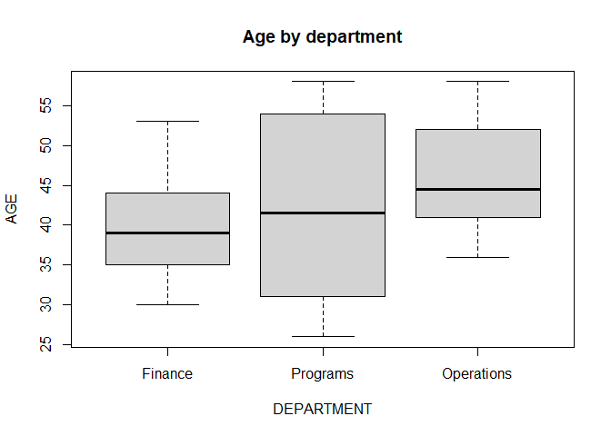<!-- -->

``` r
plot(survey_spss$SATISFACTION, col = "steelblue", main = "Satisfaction of staff")
```

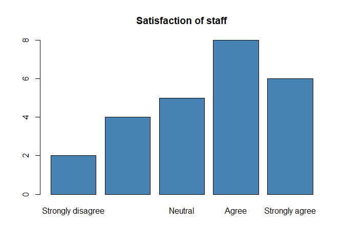<!-- -->

``` r
hist(survey_spss$AGE, col = "blue", main = "Age of staff", xlab = "Age")
```

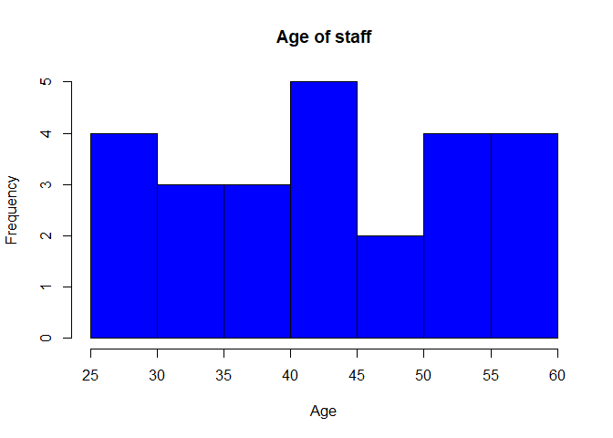<!-- -->

## 5. Data from Stata

``` r
survey_stata <- read_dta("staff_survey.dta")
head(survey_stata)
```

    ## # A tibble: 6 × 4
    ##   STAFF_ID DEPARTMENT       AGE SATISFACTION      
    ##      <dbl> <dbl+lbl>      <dbl> <dbl+lbl>         
    ## 1        1 1 [Finance]       35 3 [Neutral]       
    ## 2        2 3 [Operations]    36 2 [Disagree]      
    ## 3        3 1 [Finance]       44 5 [Strongly agree]
    ## 4        4 2 [Programs]      30 4 [Agree]         
    ## 5        5 2 [Programs]      32 5 [Strongly agree]
    ## 6        6 3 [Operations]    41 4 [Agree]

``` r
str(survey_stata)
```

    ## tibble [25 × 4] (S3: tbl_df/tbl/data.frame)
    ##  $ STAFF_ID    : num [1:25] 1 2 3 4 5 6 7 8 9 10 ...
    ##   ..- attr(*, "format.stata")= chr "%12.0g"
    ##  $ DEPARTMENT  : dbl+lbl [1:25] 1, 3, 1, 2, 2, 3, 2, 2, 3, 2, 2, 1, 3, 2, 2, 1, 2, 2, 2...
    ##    ..@ format.stata: chr "%12.0g"
    ##    ..@ labels      : Named num [1:3] 1 2 3
    ##    .. ..- attr(*, "names")= chr [1:3] "Finance" "Programs" "Operations"
    ##  $ AGE         : num [1:25] 35 36 44 30 32 41 48 58 52 26 ...
    ##   ..- attr(*, "format.stata")= chr "%12.0g"
    ##  $ SATISFACTION: dbl+lbl [1:25] 3, 2, 5, 4, 5, 4, 3, 5, 2, 5, 5, 3, 4, 1, 4, 4, 4, 3, 2...
    ##    ..@ format.stata: chr "%12.0g"
    ##    ..@ labels      : Named num [1:5] 1 2 3 4 5
    ##    .. ..- attr(*, "names")= chr [1:5] "Strongly disagree" "Disagree" "Neutral" "Agree" ...

``` r
summary(survey_stata)
```

    ##     STAFF_ID    DEPARTMENT        AGE         SATISFACTION 
    ##  Min.   : 1   Min.   :1.00   Min.   :26.00   Min.   :1.00  
    ##  1st Qu.: 7   1st Qu.:2.00   1st Qu.:35.00   1st Qu.:3.00  
    ##  Median :13   Median :2.00   Median :42.00   Median :4.00  
    ##  Mean   :13   Mean   :2.04   Mean   :42.92   Mean   :3.48  
    ##  3rd Qu.:19   3rd Qu.:2.00   3rd Qu.:52.00   3rd Qu.:4.00  
    ##  Max.   :25   Max.   :3.00   Max.   :58.00   Max.   :5.00

Here satisfaction is kept as a score from 1 to 5, so we can calculate
its mean.

``` r
survey_stata$DEPARTMENT <- as_factor(survey_stata$DEPARTMENT)
survey_stata$SATISFACTION <- as.numeric(survey_stata$SATISFACTION)
by(survey_stata$SATISFACTION, survey_stata$DEPARTMENT, mean)
```

    ## survey_stata$DEPARTMENT: Finance
    ## [1] 3.2
    ## ------------------------------------------------------------ 
    ## survey_stata$DEPARTMENT: Programs
    ## [1] 3.714286
    ## ------------------------------------------------------------ 
    ## survey_stata$DEPARTMENT: Operations
    ## [1] 3.166667

``` r
xtabs(~ DEPARTMENT, data = survey_stata)
```

    ## DEPARTMENT
    ##    Finance   Programs Operations 
    ##          5         14          6

``` r
boxplot(SATISFACTION ~ DEPARTMENT, data = survey_stata, main = "Satisfaction score by department")
```

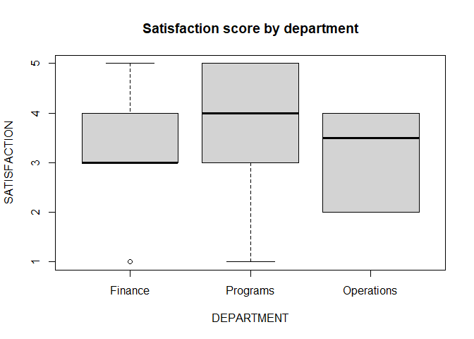<!-- -->

``` r
plot(SATISFACTION ~ AGE, data = survey_stata, main = "Satisfaction and age")
```

<!-- -->

``` r
hist(survey_stata$SATISFACTION, col = "blue", main = "Satisfaction score", xlab = "Score (1 to 5)")
```

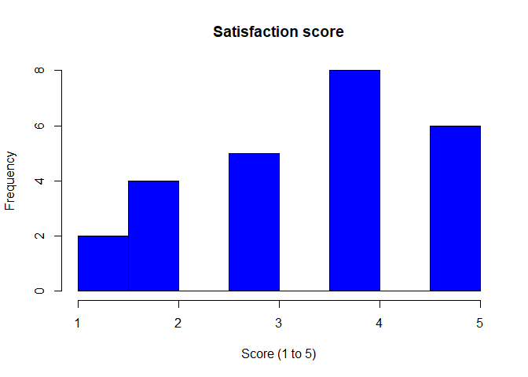<!-- -->

## 6. Data from SAS

``` r
survey_sas <- read_xpt("staff_survey.xpt")
head(survey_sas)
```

    ## # A tibble: 6 × 4
    ##   STAFF_ID DEPARTMENT   AGE SATISFACTION
    ##      <dbl>      <dbl> <dbl>        <dbl>
    ## 1        1          1    35            3
    ## 2        2          3    36            2
    ## 3        3          1    44            5
    ## 4        4          2    30            4
    ## 5        5          2    32            5
    ## 6        6          3    41            4

``` r
str(survey_sas)
```

    ## tibble [25 × 4] (S3: tbl_df/tbl/data.frame)
    ##  $ STAFF_ID    : num [1:25] 1 2 3 4 5 6 7 8 9 10 ...
    ##  $ DEPARTMENT  : num [1:25] 1 3 1 2 2 3 2 2 3 2 ...
    ##  $ AGE         : num [1:25] 35 36 44 30 32 41 48 58 52 26 ...
    ##  $ SATISFACTION: num [1:25] 3 2 5 4 5 4 3 5 2 5 ...

``` r
summary(survey_sas)
```

    ##     STAFF_ID    DEPARTMENT        AGE         SATISFACTION 
    ##  Min.   : 1   Min.   :1.00   Min.   :26.00   Min.   :1.00  
    ##  1st Qu.: 7   1st Qu.:2.00   1st Qu.:35.00   1st Qu.:3.00  
    ##  Median :13   Median :2.00   Median :42.00   Median :4.00  
    ##  Mean   :13   Mean   :2.04   Mean   :42.92   Mean   :3.48  
    ##  3rd Qu.:19   3rd Qu.:2.00   3rd Qu.:52.00   3rd Qu.:4.00  
    ##  Max.   :25   Max.   :3.00   Max.   :58.00   Max.   :5.00

The SAS file stores department as a number (1 = Finance, 2 = Programs, 3
= Operations).

``` r
by(survey_sas$AGE, survey_sas$DEPARTMENT, mean)
```

    ## survey_sas$DEPARTMENT: 1
    ## [1] 40.2
    ## ------------------------------------------------------------ 
    ## survey_sas$DEPARTMENT: 2
    ## [1] 42.57143
    ## ------------------------------------------------------------ 
    ## survey_sas$DEPARTMENT: 3
    ## [1] 46

``` r
xtabs(~ DEPARTMENT + SATISFACTION, data = survey_sas)
```

    ##           SATISFACTION
    ## DEPARTMENT 1 2 3 4 5
    ##          1 1 0 2 1 1
    ##          2 1 2 2 4 5
    ##          3 0 2 1 3 0

``` r
boxplot(AGE ~ DEPARTMENT, data = survey_sas, main = "Age by department code")
```

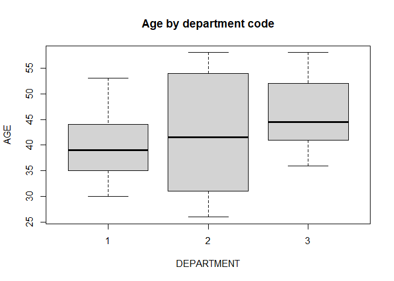<!-- -->

``` r
plot(SATISFACTION ~ AGE, data = survey_sas, main = "Satisfaction and age")
```

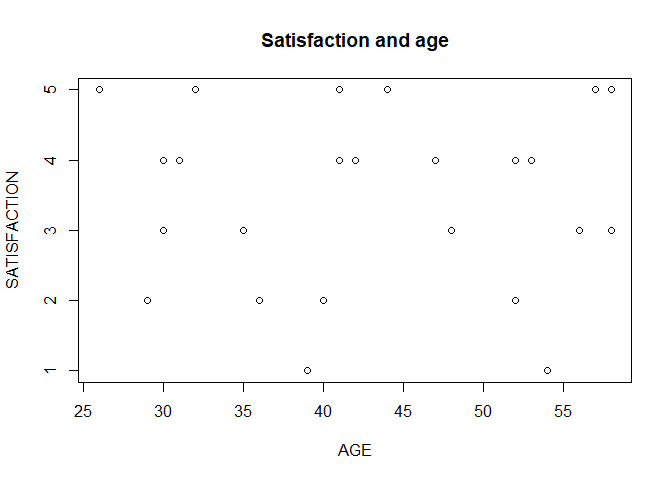<!-- -->

``` r
hist(survey_sas$AGE, col = "blue", main = "Age of staff", xlab = "Age")
```

<!-- -->

## 7. Data from a database (SQLite)

The `DBI` package connects to the database, and `RSQLite` is the driver
for SQLite. The same functions work for MySQL, Oracle or Access with a
different driver.

``` r
con <- dbConnect(SQLite(), "procurement.sqlite")
dbListTables(con)
```

    ## [1] "purchase_orders" "suppliers"

``` r
suppliers <- dbReadTable(con, "suppliers")
orders_db <- dbReadTable(con, "purchase_orders")
head(suppliers)
```

    ##                 SUPPLIER LOCATION RATING
    ## 1 Kigali Office Supplies   Kigali    4.5
    ## 2        Ubumwe Catering   Kigali    4.0
    ## 3        Rwanda Tech Ltd   Kigali    4.2
    ## 4             Clean Plus   Kigali    3.8

``` r
str(suppliers)
```

    ## 'data.frame':    4 obs. of  3 variables:
    ##  $ SUPPLIER: chr  "Kigali Office Supplies" "Ubumwe Catering" "Rwanda Tech Ltd" "Clean Plus"
    ##  $ LOCATION: chr  "Kigali" "Kigali" "Kigali" "Kigali"
    ##  $ RATING  : num  4.5 4 4.2 3.8

``` r
summary(suppliers)
```

    ##       SUPPLIER       LOCATION     RATING     
    ##  Length   : 4   Length   :4   Min.   :3.800  
    ##  N.unique : 4   N.unique :1   1st Qu.:3.950  
    ##  N.blank  : 0   N.blank  :0   Median :4.100  
    ##  Min.nchar:10   Min.nchar:6   Mean   :4.125  
    ##  Max.nchar:22   Max.nchar:6   3rd Qu.:4.275  
    ##                               Max.   :4.500

An SQL query can select only the data needed:

``` r
dbGetQuery(con, "SELECT SUPPLIER, COUNT(*) AS ORDERS, AVG(DELIVERY_DAYS) AS AVG_DAYS
                 FROM purchase_orders
                 GROUP BY SUPPLIER")
```

    ##                 SUPPLIER ORDERS AVG_DAYS
    ## 1             Clean Plus      9 7.666667
    ## 2 Kigali Office Supplies      9 6.444444
    ## 3        Rwanda Tech Ltd     14 6.333333
    ## 4        Ubumwe Catering      8 8.875000

``` r
dbDisconnect(con)
```

Merging the suppliers with the orders, using the supplier name as the
key:

``` r
orders_suppliers <- merge(orders_db, suppliers, by = "SUPPLIER")
head(orders_suppliers[, c("PO_ID", "SUPPLIER", "LOCATION", "RATING", "DELIVERY_DAYS")])
```

    ##   PO_ID   SUPPLIER LOCATION RATING DELIVERY_DAYS
    ## 1 PO009 Clean Plus   Kigali    3.8            13
    ## 2 PO006 Clean Plus   Kigali    3.8             4
    ## 3 PO015 Clean Plus   Kigali    3.8            11
    ## 4 PO017 Clean Plus   Kigali    3.8             7
    ## 5 PO022 Clean Plus   Kigali    3.8             3
    ## 6 PO032 Clean Plus   Kigali    3.8             6

``` r
by(orders_suppliers$DELIVERY_DAYS, orders_suppliers$RATING, mean, na.rm = TRUE)
```

    ## orders_suppliers$RATING: 3.8
    ## [1] 7.666667
    ## ------------------------------------------------------------ 
    ## orders_suppliers$RATING: 4
    ## [1] 8.875
    ## ------------------------------------------------------------ 
    ## orders_suppliers$RATING: 4.2
    ## [1] 6.333333
    ## ------------------------------------------------------------ 
    ## orders_suppliers$RATING: 4.5
    ## [1] 6.444444

``` r
xtabs(~ SUPPLIER + RATING, data = orders_suppliers)
```

    ##                         RATING
    ## SUPPLIER                 3.8  4 4.2 4.5
    ##   Clean Plus               9  0   0   0
    ##   Kigali Office Supplies   0  0   0   9
    ##   Rwanda Tech Ltd          0  0  14   0
    ##   Ubumwe Catering          0  8   0   0

``` r
boxplot(DELIVERY_DAYS ~ RATING, data = orders_suppliers, main = "Delivery days by supplier rating")
```

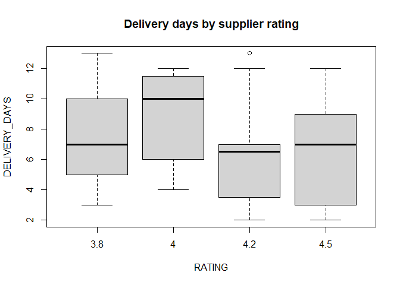<!-- -->

``` r
plot(DELIVERY_DAYS ~ RATING, data = orders_suppliers, main = "Supplier rating and delivery days")
```

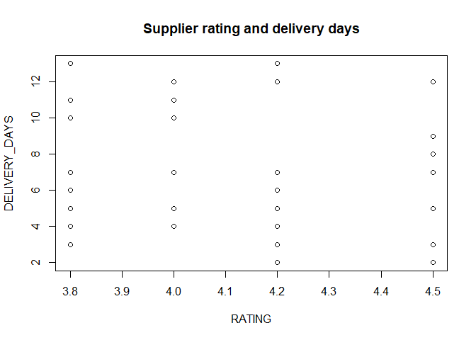<!-- -->

``` r
hist(orders_suppliers$DELIVERY_DAYS, col = "blue", main = "Delivery days", xlab = "Days")
```

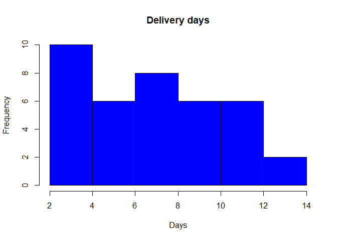<!-- -->

## Conclusion

R reads text and CSV files without extra packages. The `readxl` package
imports Excel files, `haven` imports SPSS, Stata and SAS files with
their labels, and `DBI` with `RSQLite` imports tables from a database
using SQL. After importing, all the data becomes a data frame, so the
same tools from class (`head()`, `str()`, `summary()`, `by()`,
`xtabs()`, `boxplot()`, `plot()`, `hist()` and `merge()`) work on every
dataset.
