R for data science: Assignment 2
================
Moise Tuyizere
2026-10-31

## Introduction

This assignment uses the `ggplot2` package to draw graphs with the
following functions:

`geom_bar()`, `geom_boxplot()`, `geom_density()`, `geom_histogram()`,
`geom_hline()`, `geom_jitter()`, `geom_violin()`, `geom_text()`,
`geom_smooth()`, `geom_line()`, `geom_point()`, `geom_rug()` and
`geom_vline()`.

## How ggplot2 works

Every graph is built in layers:

1.  `ggplot(data, aes(x, y))` gives the data and says which variables go
    on each axis.
2.  A `geom_` function adds the shape (bars, points, lines, boxes).
3.  More layers can be added with `+` (titles, lines, labels).

## Packages

``` r
install.packages("ggplot2")
```

``` r
library(ggplot2)
library(lattice)   # comes with R and contains the singer data
```

## Data

Three datasets that come with R are used, so no files are needed.

``` r
data(singer)       # height of 235 singers and their voice part
head(singer)
```

    ##   height voice.part
    ## 1     64  Soprano 1
    ## 2     62  Soprano 1
    ## 3     66  Soprano 1
    ## 4     65  Soprano 1
    ## 5     60  Soprano 1
    ## 6     61  Soprano 1

``` r
str(singer)
```

    ## 'data.frame':    235 obs. of  2 variables:
    ##  $ height    : num  64 62 66 65 60 61 65 66 65 63 ...
    ##  $ voice.part: Factor w/ 8 levels "Bass 2","Bass 1",..: 8 8 8 8 8 8 8 8 8 8 ...

``` r
summary(singer)
```

    ##      height         voice.part
    ##  Min.   :60.0   Bass 1   :39  
    ##  1st Qu.:65.0   Soprano 1:36  
    ##  Median :67.0   Alto 1   :35  
    ##  Mean   :67.3   Soprano 2:30  
    ##  3rd Qu.:70.0   Alto 2   :27  
    ##  Max.   :76.0   Bass 2   :26  
    ##                 (Other)  :42

``` r
data(mtcars)       # fuel consumption and design of 32 cars
head(mtcars[, c("mpg", "wt", "hp", "cyl")])
```

    ##                    mpg    wt  hp cyl
    ## Mazda RX4         21.0 2.620 110   6
    ## Mazda RX4 Wag     21.0 2.875 110   6
    ## Datsun 710        22.8 2.320  93   4
    ## Hornet 4 Drive    21.4 3.215 110   6
    ## Hornet Sportabout 18.7 3.440 175   8
    ## Valiant           18.1 3.460 105   6

``` r
data(economics)    # monthly US economic data, from ggplot2
head(economics[, c("date", "unemploy")])
```

    ## # A tibble: 6 × 2
    ##   date       unemploy
    ##   <date>        <dbl>
    ## 1 1967-07-01     2944
    ## 2 1967-08-01     2945
    ## 3 1967-09-01     2958
    ## 4 1967-10-01     3143
    ## 5 1967-11-01     3066
    ## 6 1967-12-01     3018

## 1. geom_bar()

A bar chart counts how many observations fall in each category. Here:
number of singers in each voice part.

``` r
ggplot(singer, aes(x = voice.part)) +
  geom_bar(fill = "steelblue") +
  labs(title = "Number of singers by voice part", x = "Voice part", y = "Count")
```

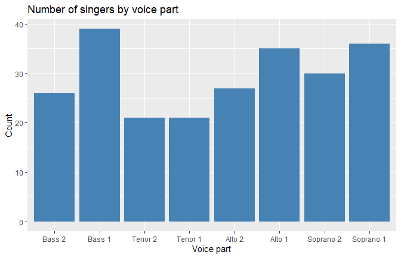<!-- -->

## 2. geom_histogram()

A histogram shows the distribution of a continuous variable.

``` r
ggplot(singer, aes(x = height)) +
  geom_histogram(binwidth = 2, fill = "steelblue", colour = "white") +
  labs(title = "Height of singers", x = "Height (inches)", y = "Count")
```

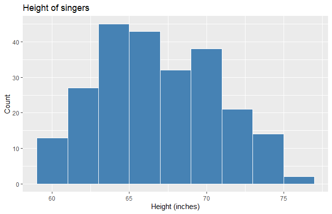<!-- -->

## 3. geom_density()

A density plot is a smooth version of the histogram. Filling by voice
part compares the groups.

``` r
ggplot(singer, aes(x = height, fill = voice.part)) +
  geom_density(alpha = 0.4) +
  labs(title = "Height distribution by voice part", x = "Height (inches)")
```

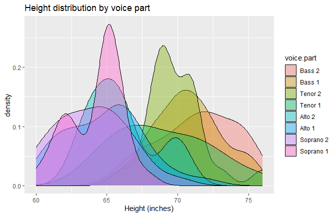<!-- -->

## 4. geom_vline()

`geom_vline()` adds a vertical line. Here it marks the mean height on
the histogram.

``` r
ggplot(singer, aes(x = height)) +
  geom_histogram(binwidth = 2, fill = "steelblue", colour = "white") +
  geom_vline(xintercept = mean(singer$height), colour = "red", linewidth = 1) +
  labs(title = "Height of singers with the mean (red line)", x = "Height (inches)")
```

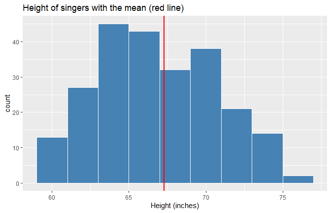<!-- -->

## 5. geom_rug()

`geom_rug()` draws a small tick for every observation along the axis, so
the real data points are visible under the density curve.

``` r
ggplot(singer, aes(x = height)) +
  geom_density(fill = "lightblue") +
  geom_rug() +
  labs(title = "Density of height with rug", x = "Height (inches)")
```

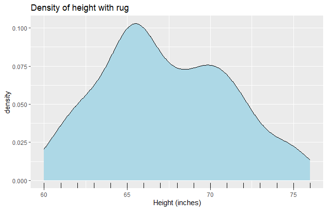<!-- -->

## 6. geom_boxplot()

A boxplot compares a continuous variable across categories, the same as
`boxplot()` in base R.

``` r
ggplot(singer, aes(x = voice.part, y = height)) +
  geom_boxplot(fill = "lightblue") +
  labs(title = "Height by voice part", x = "Voice part", y = "Height (inches)")
```

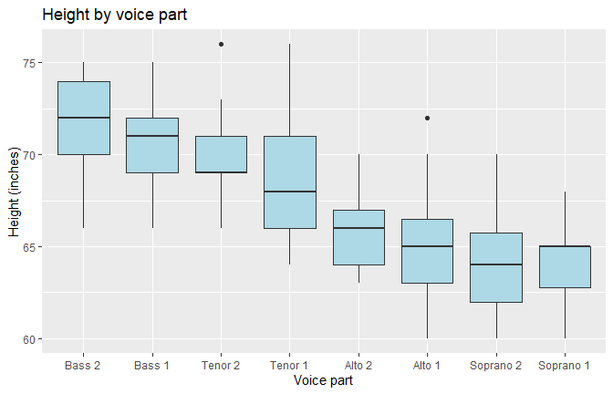<!-- -->

Lower voices (Bass, Tenor) are taller than higher voices (Alto,
Soprano).

## 7. geom_violin()

A violin plot works like a boxplot but shows the full shape of the
distribution.

``` r
ggplot(singer, aes(x = voice.part, y = height)) +
  geom_violin(fill = "lightgreen") +
  labs(title = "Height by voice part (violin)", x = "Voice part", y = "Height (inches)")
```

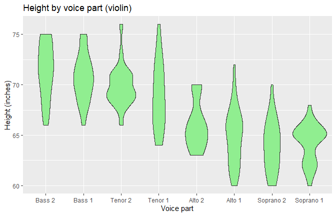<!-- -->

## 8. geom_jitter()

`geom_jitter()` draws each singer as a point and moves the points
slightly sideways so they do not overlap.

``` r
ggplot(singer, aes(x = voice.part, y = height)) +
  geom_boxplot(outlier.shape = NA) +
  geom_jitter(width = 0.2, alpha = 0.5, colour = "darkblue") +
  labs(title = "Height by voice part with every singer shown",
       x = "Voice part", y = "Height (inches)")
```

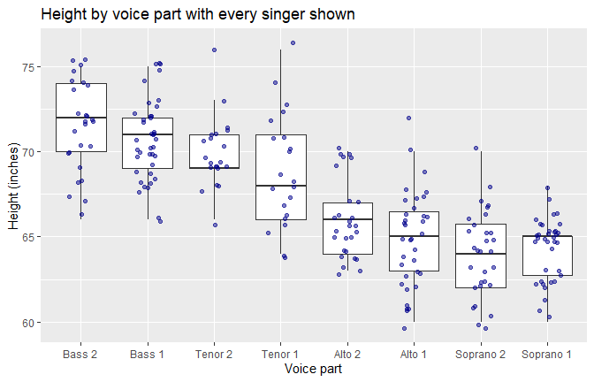<!-- -->

## 9. geom_point()

A scatter plot shows the relationship between two continuous variables,
the same as `plot()` in base R.

``` r
ggplot(mtcars, aes(x = wt, y = mpg)) +
  geom_point(colour = "darkblue", size = 2) +
  labs(title = "Car weight and fuel consumption",
       x = "Weight (1000 lbs)", y = "Miles per gallon")
```

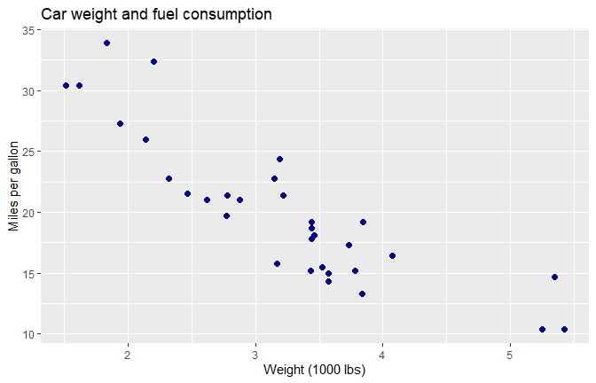<!-- -->

## 10. geom_smooth()

`geom_smooth(method = "lm")` adds the linear regression line, the same
as `abline(lm())` in base R.

``` r
ggplot(mtcars, aes(x = wt, y = mpg)) +
  geom_point() +
  geom_smooth(method = "lm", colour = "red") +
  labs(title = "Car weight and fuel consumption with regression line",
       x = "Weight (1000 lbs)", y = "Miles per gallon")
```

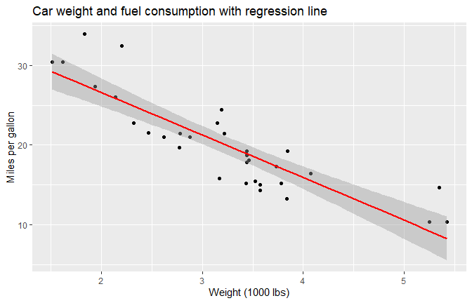<!-- -->

``` r
cor(mtcars$wt, mtcars$mpg)
```

    ## [1] -0.8676594

Heavier cars use more fuel (fewer miles per gallon).

## 11. geom_text()

`geom_text()` writes labels on the graph. Here each point shows the car
name.

``` r
ggplot(mtcars, aes(x = wt, y = mpg, label = rownames(mtcars))) +
  geom_point() +
  geom_text(size = 2.5, vjust = -0.7) +
  labs(title = "Car names on the scatter plot",
       x = "Weight (1000 lbs)", y = "Miles per gallon")
```

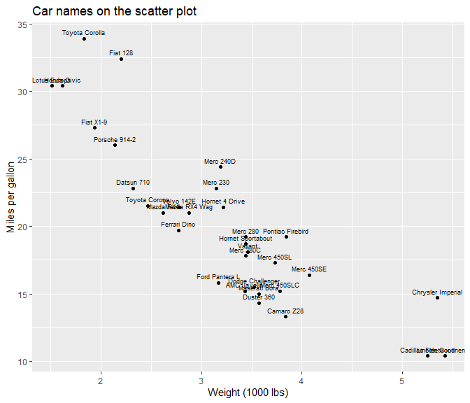<!-- -->

## 12. geom_hline()

`geom_hline()` adds a horizontal line. Here it marks the average fuel
consumption, so cars above the line are more efficient than average.

``` r
ggplot(mtcars, aes(x = hp, y = mpg)) +
  geom_point() +
  geom_hline(yintercept = mean(mtcars$mpg), colour = "red", linetype = "dashed") +
  labs(title = "Horsepower and fuel consumption (red line = mean mpg)",
       x = "Horsepower", y = "Miles per gallon")
```

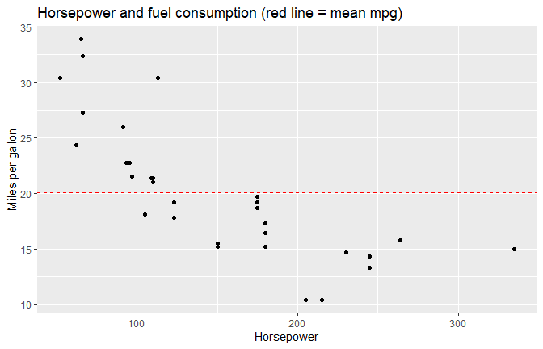<!-- -->

## 13. geom_line()

`geom_line()` joins the points in order, which suits data over time.

``` r
ggplot(economics, aes(x = date, y = unemploy / 1000)) +
  geom_line(colour = "steelblue") +
  labs(title = "Unemployment in the USA over time",
       x = "Year", y = "Unemployed (millions)")
```

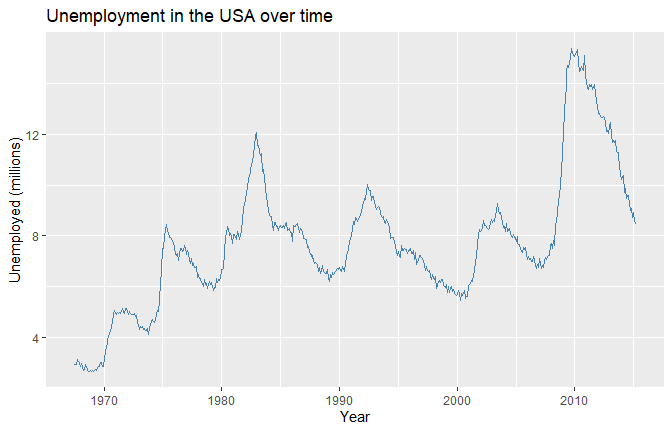<!-- -->

## Combining several geoms

Many functions can be added to one graph. This one uses `geom_point()`,
`geom_smooth()`, `geom_hline()`, `geom_vline()` and `geom_rug()`
together, with colour by number of cylinders.

``` r
ggplot(mtcars, aes(x = wt, y = mpg, colour = factor(cyl))) +
  geom_point(size = 2) +
  geom_smooth(method = "lm", se = FALSE) +
  geom_hline(yintercept = mean(mtcars$mpg), linetype = "dashed") +
  geom_vline(xintercept = mean(mtcars$wt), linetype = "dashed") +
  geom_rug() +
  labs(title = "Weight and fuel consumption by number of cylinders",
       x = "Weight (1000 lbs)", y = "Miles per gallon", colour = "Cylinders")
```

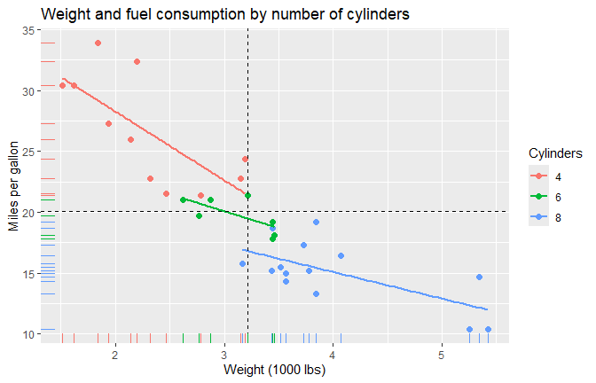<!-- -->

## Conclusion

`ggplot2` builds graphs in layers. The data and axes are set once in
`ggplot()`, then each `geom_` function adds a different view:
`geom_bar()` for counts, `geom_histogram()`, `geom_density()` and
`geom_rug()` for distributions, `geom_boxplot()`, `geom_violin()` and
`geom_jitter()` to compare groups, `geom_point()`, `geom_smooth()` and
`geom_text()` for relationships, `geom_line()` for time, and
`geom_hline()` and `geom_vline()` for reference lines.
