R for data science: Assignment 3
================
Moise Tuyizere
2026-10-31

## Introduction

This assignment practises everything covered in class 1 (R for data
science, Dr. Pacifique), using our own datasets instead of the class
data:

| Data | Used for |
|----|----|
| students.txt (height, weight and gender of 30 students) | importation, summary statistics, scatter plot, linear model, BMI |
| purchase_orders.csv (40 purchase orders) | categorical vs continuous, cross tables, bar chart, missing values, merging |
| Supplier evaluation survey (typed in below) | creating data, missing values coded 99, sorting, subsetting |

Both files are saved in the same folder as this R Markdown file.

``` r
data_folder <- "C:/Users/smartsource ltd/Downloads/Assignment2"
setwd(data_folder)
knitr::opts_knit$set(root.dir = data_folder)
```

## Today’s class, we will study

- Calculator in R
- Data structure (vectors, factors, lists, data frame, matrix and
  arrays)
- Data importation in R
- Data description using numerical measures and graphs
- Data management

## Calculator in R

R works like a calculator. Example: the cost of 25 reams of paper at
6,500 RWF each, plus 18% VAT.

``` r
25 * 6500
```

    ## [1] 162500

``` r
25 * 6500 * 1.18
```

    ## [1] 191750

``` r
sqrt(144)
```

    ## [1] 12

``` r
(120 + 80) / 4
```

    ## [1] 50

## Data structure (Vectors, Factors, Lists, Data frame, matrix and arrays)

### Vector: the foundational R data structure

#### Numeric

Example 1: unit prices of four items (RWF).

``` r
x <- c(0.5, 0.6)
price <- c(6500, 45000, 1200, 3800)
summary(price)
```

    ##    Min. 1st Qu.  Median    Mean 3rd Qu.    Max. 
    ##    1200    3150    5150   14125   16125   45000

Example 2: delivery days of four orders.

``` r
days <- c(5, 12, 3, 8)
mean(days)
```

    ## [1] 7

#### Logical

Was each order delivered on time?

``` r
on_time <- c(TRUE, FALSE, TRUE, TRUE)
on_time <- c(T, F, T, T)
on_time
```

    ## [1]  TRUE FALSE  TRUE  TRUE

#### Character

``` r
x <- c("a", "b", "c")
category <- c("Stationery", "IT Equipment", "Cleaning", "Catering")
category
```

    ## [1] "Stationery"   "IT Equipment" "Cleaning"     "Catering"

#### Integer

``` r
po_number <- 1:10
po_number
```

    ##  [1]  1  2  3  4  5  6  7  8  9 10

``` r
class(po_number)
```

    ## [1] "integer"

#### Complex

``` r
x <- c(1+0i, 2+4i)
x
```

    ## [1] 1+0i 2+4i

``` r
class(x)
```

    ## [1] "complex"

### Matrix and operation within matrices

Two orders (rows) for three items (columns). Multiplying the quantity
matrix by the price matrix gives the cost of each order.

``` r
(quantity <- matrix(c(10, 5, 2, 4, 0, 6), nrow = 2, ncol = 3,
                    dimnames = list(c("Order1", "Order2"), c("Paper", "Toner", "Pens"))))
```

    ##        Paper Toner Pens
    ## Order1    10     2    0
    ## Order2     5     4    6

``` r
(unit_price <- matrix(c(6500, 45000, 1200), nrow = 3, ncol = 1,
                      dimnames = list(c("Paper", "Toner", "Pens"), "Price")))
```

    ##       Price
    ## Paper  6500
    ## Toner 45000
    ## Pens   1200

``` r
quantity %*% unit_price
```

    ##         Price
    ## Order1 155000
    ## Order2 219700

### List

A list can hold different types of data together, like the details of
one purchase order.

``` r
(order <- list("PO001", "Kigali Office Supplies", 25, TRUE))
```

    ## [[1]]
    ## [1] "PO001"
    ## 
    ## [[2]]
    ## [1] "Kigali Office Supplies"
    ## 
    ## [[3]]
    ## [1] 25
    ## 
    ## [[4]]
    ## [1] TRUE

### Factor

``` r
status <- factor(c("Delivered", "Delivered", "Pending", "Delivered", "Cancelled"))
status
```

    ## [1] Delivered Delivered Pending   Delivered Cancelled
    ## Levels: Cancelled Delivered Pending

``` r
levels(status)
```

    ## [1] "Cancelled" "Delivered" "Pending"

``` r
table(status)
```

    ## status
    ## Cancelled Delivered   Pending 
    ##         1         3         1

### Missing values

Create a vector with NAs in it, then find which elements are NA.

``` r
delivery_days <- c(5, 7, NA, 10, 3)
is.na(delivery_days)
```

    ## [1] FALSE FALSE  TRUE FALSE FALSE

``` r
mean(delivery_days)
```

    ## [1] NA

``` r
mean(delivery_days, na.rm = TRUE)
```

    ## [1] 6.25

When “NA” is written in quotes, R treats it as text, not as a missing
value:

``` r
x <- c(1, 2, 4, "NA", 5)
bad <- is.na(x)
print(bad)
```

    ## [1] FALSE FALSE FALSE FALSE FALSE

``` r
x[!bad]
```

    ## [1] "1"  "2"  "4"  "NA" "5"

Keeping only the cases with no missing value in any of several objects:

``` r
supplier <- c("S1", "S2", NA, "S4", NA, "S6")
amount <- c(120000, 85000, NA, 64000, 230000, 47000)
good <- complete.cases(supplier, amount)
good
```

    ## [1]  TRUE  TRUE FALSE  TRUE FALSE  TRUE

``` r
supplier[good]
```

    ## [1] "S1" "S2" "S4" "S6"

``` r
amount[good]
```

    ## [1] 120000  85000  64000  47000

### Coercion

If a character is present in a vector, R converts everything to
character strings. If a vector only has logical values and numbers, TRUE
becomes 1 and FALSE becomes 0, so `sum()` counts the TRUE values.

``` r
c(1, "Paper", TRUE)
```

    ## [1] "1"     "Paper" "TRUE"

``` r
sum(c(TRUE, TRUE, FALSE, TRUE, FALSE))   # number of orders delivered on time
```

    ## [1] 3

## Create data

A data frame is more general than a matrix because it can hold different
types of data (numeric, character and so on), like a sheet in SPSS or
Excel.

``` r
supplierID <- c(1, 2, 3, 4, 5)
supplier_name <- c("Kigali Office Supplies", "Rwanda Tech Ltd", "Clean Plus",
                   "Ubumwe Catering", "Musanze Hardware")
location <- c("Kigali", "Kigali", "Kigali", "Kigali", "Musanze")
quality_score <- c(8, 7, 9, 6, NA)
price_score <- c(7, 6, 8, 9, 5)
supplierdata <- data.frame(supplierID, supplier_name, location, quality_score, price_score)
supplierdata
```

    ##   supplierID          supplier_name location quality_score price_score
    ## 1          1 Kigali Office Supplies   Kigali             8           7
    ## 2          2        Rwanda Tech Ltd   Kigali             7           6
    ## 3          3             Clean Plus   Kigali             9           8
    ## 4          4        Ubumwe Catering   Kigali             6           9
    ## 5          5       Musanze Hardware  Musanze            NA           5

``` r
View(supplierdata)   # opens the data in a viewer, run in RStudio only
```

### Create data from keyboard

Step 1: create a data frame with variable names. Step 2: open the editor
on it and type the data. This only works in RStudio, so it is not run
when knitting.

``` r
new_order <- data.frame(item = character(0), quantity = numeric(0), price = numeric(0))
new_order <- edit(new_order)
```

## Data Importation

R can import data from text files, spreadsheets, statistical packages
(SAS, SPSS, Stata) and database management systems (SQL, MySQL, Oracle,
Access).

### Data from a text file

``` r
data_class <- read.table("students.txt", header = TRUE)
variable.names(data_class)
```

    ## [1] "ID"     "GENDER" "HEIGHT" "WEIGHT"

``` r
head(data_class)
```

    ##   ID GENDER HEIGHT WEIGHT
    ## 1  1      M    156     50
    ## 2  2      M    162     52
    ## 3  3      M    168     44
    ## 4  4      F    162     56
    ## 5  5      F    156     49
    ## 6  6      F    150     53

``` r
tail(data_class)
```

    ##    ID GENDER HEIGHT WEIGHT
    ## 25 25      F    152     50
    ## 26 26      F    162     57
    ## 27 27      M    164     52
    ## 28 28      M    149     46
    ## 29 29      M    165     48
    ## 30 30      F    157     49

``` r
data_class[10:20, ]
```

    ##    ID GENDER HEIGHT WEIGHT
    ## 10 10      F    161     52
    ## 11 11      M    163     49
    ## 12 12      M    178     61
    ## 13 13      M    162     57
    ## 14 14      M    161     46
    ## 15 15      F    162     49
    ## 16 16      F    153     54
    ## 17 17      F    168     53
    ## 18 18      F    167     56
    ## 19 19      F    155     46
    ## 20 20      M    163     47

``` r
summary(data_class$WEIGHT)
```

    ##    Min. 1st Qu.  Median    Mean 3rd Qu.    Max. 
    ##   44.00   48.25   50.50   51.60   54.75   64.00

``` r
length(data_class$WEIGHT)
```

    ## [1] 30

``` r
data_class[, -1]
```

    ##    GENDER HEIGHT WEIGHT
    ## 1       M    156     50
    ## 2       M    162     52
    ## 3       M    168     44
    ## 4       F    162     56
    ## 5       F    156     49
    ## 6       F    150     53
    ## 7       M    161     60
    ## 8       M    166     51
    ## 9       M    167     64
    ## 10      F    161     52
    ## 11      M    163     49
    ## 12      M    178     61
    ## 13      M    162     57
    ## 14      M    161     46
    ## 15      F    162     49
    ## 16      F    153     54
    ## 17      F    168     53
    ## 18      F    167     56
    ## 19      F    155     46
    ## 20      M    163     47
    ## 21      F    161     45
    ## 22      F    151     48
    ## 23      M    154     49
    ## 24      M    158     55
    ## 25      F    152     50
    ## 26      F    162     57
    ## 27      M    164     52
    ## 28      M    149     46
    ## 29      M    165     48
    ## 30      F    157     49

``` r
data_class$WEIGHT
```

    ##  [1] 50 52 44 56 49 53 60 51 64 52 49 61 57 46 49 54 53 56 46 47 45 48 49 55 50
    ## [26] 57 52 46 48 49

### Data from a CSV file

``` r
orders <- read.csv("purchase_orders.csv")
head(orders)
```

    ##   PO_ID               SUPPLIER     CATEGORY QUANTITY UNIT_PRICE DELIVERY_DAYS
    ## 1 PO001 Kigali Office Supplies   Stationery       98      42600             3
    ## 2 PO002        Ubumwe Catering     Catering       28      18900             7
    ## 3 PO003 Kigali Office Supplies   Stationery       26      20600             3
    ## 4 PO004        Rwanda Tech Ltd IT Equipment       93      41400             3
    ## 5 PO005        Rwanda Tech Ltd IT Equipment       80      44700            NA
    ## 6 PO006             Clean Plus     Cleaning       58      42100             4

``` r
str(orders)
```

    ## 'data.frame':    40 obs. of  6 variables:
    ##  $ PO_ID        : chr  "PO001" "PO002" "PO003" "PO004" ...
    ##  $ SUPPLIER     : chr  "Kigali Office Supplies" "Ubumwe Catering" "Kigali Office Supplies" "Rwanda Tech Ltd" ...
    ##  $ CATEGORY     : chr  "Stationery" "Catering" "Stationery" "IT Equipment" ...
    ##  $ QUANTITY     : int  98 28 26 93 80 58 100 12 87 66 ...
    ##  $ UNIT_PRICE   : int  42600 18900 20600 41400 44700 42100 24200 48200 30500 37100 ...
    ##  $ DELIVERY_DAYS: int  3 7 3 3 NA 4 11 10 13 4 ...

### In case you want to use a dataset built in R

``` r
data()   # list of datasets currently available
```

``` r
data("airquality")
variable.names(airquality)
```

    ## [1] "Ozone"   "Solar.R" "Wind"    "Temp"    "Month"   "Day"

``` r
str(airquality)
```

    ## 'data.frame':    153 obs. of  6 variables:
    ##  $ Ozone  : int  41 36 12 18 NA 28 23 19 8 NA ...
    ##  $ Solar.R: int  190 118 149 313 NA NA 299 99 19 194 ...
    ##  $ Wind   : num  7.4 8 12.6 11.5 14.3 14.9 8.6 13.8 20.1 8.6 ...
    ##  $ Temp   : int  67 72 74 62 56 66 65 59 61 69 ...
    ##  $ Month  : int  5 5 5 5 5 5 5 5 5 5 ...
    ##  $ Day    : int  1 2 3 4 5 6 7 8 9 10 ...

## Exploration data analysis

### Examine numerical variables using common summary

``` r
data_class
```

    ##    ID GENDER HEIGHT WEIGHT
    ## 1   1      M    156     50
    ## 2   2      M    162     52
    ## 3   3      M    168     44
    ## 4   4      F    162     56
    ## 5   5      F    156     49
    ## 6   6      F    150     53
    ## 7   7      M    161     60
    ## 8   8      M    166     51
    ## 9   9      M    167     64
    ## 10 10      F    161     52
    ## 11 11      M    163     49
    ## 12 12      M    178     61
    ## 13 13      M    162     57
    ## 14 14      M    161     46
    ## 15 15      F    162     49
    ## 16 16      F    153     54
    ## 17 17      F    168     53
    ## 18 18      F    167     56
    ## 19 19      F    155     46
    ## 20 20      M    163     47
    ## 21 21      F    161     45
    ## 22 22      F    151     48
    ## 23 23      M    154     49
    ## 24 24      M    158     55
    ## 25 25      F    152     50
    ## 26 26      F    162     57
    ## 27 27      M    164     52
    ## 28 28      M    149     46
    ## 29 29      M    165     48
    ## 30 30      F    157     49

``` r
summary(data_class)
```

    ##        ID              GENDER       HEIGHT          WEIGHT     
    ##  Min.   : 1.00   Length   :30   Min.   :149.0   Min.   :44.00  
    ##  1st Qu.: 8.25   N.unique : 2   1st Qu.:156.0   1st Qu.:48.25  
    ##  Median :15.50   N.blank  : 0   Median :161.5   Median :50.50  
    ##  Mean   :15.50   Min.nchar: 1   Mean   :160.5   Mean   :51.60  
    ##  3rd Qu.:22.75   Max.nchar: 1   3rd Qu.:163.8   3rd Qu.:54.75  
    ##  Max.   :30.00                  Max.   :178.0   Max.   :64.00

``` r
str(data_class)
```

    ## 'data.frame':    30 obs. of  4 variables:
    ##  $ ID    : int  1 2 3 4 5 6 7 8 9 10 ...
    ##  $ GENDER: chr  "M" "M" "M" "F" ...
    ##  $ HEIGHT: int  156 162 168 162 156 150 161 166 167 161 ...
    ##  $ WEIGHT: int  50 52 44 56 49 53 60 51 64 52 ...

### Summary Statistics

``` r
apply(data_class[, c("HEIGHT", "WEIGHT")], 1, mean)
```

    ##  [1] 103.0 107.0 106.0 109.0 102.5 101.5 110.5 108.5 115.5 106.5 106.0 119.5
    ## [13] 109.5 103.5 105.5 103.5 110.5 111.5 100.5 105.0 103.0  99.5 101.5 106.5
    ## [25] 101.0 109.5 108.0  97.5 106.5 103.0

``` r
apply(data_class[, c("HEIGHT", "WEIGHT")], 2, sd)
```

    ##   HEIGHT   WEIGHT 
    ## 6.388208 4.959143

``` r
c(mean(data_class$HEIGHT), sd(data_class$HEIGHT))
```

    ## [1] 160.466667   6.388208

``` r
c(mean(data_class$WEIGHT), sd(data_class$WEIGHT))
```

    ## [1] 51.600000  4.959143

``` r
c(Mean = mean(data_class$HEIGHT), SD = sd(data_class$HEIGHT))
```

    ##       Mean         SD 
    ## 160.466667   6.388208

``` r
c(Mean = mean(data_class$WEIGHT), SD = sd(data_class$WEIGHT))
```

    ##      Mean        SD 
    ## 51.600000  4.959143

## Variation and covariation using both numbers and graphs

### Relationship between a categorical and a continuous variable

Does the unit price differ between categories of items?

``` r
mean(orders$UNIT_PRICE)
```

    ## [1] 29747.5

``` r
mean(orders$UNIT_PRICE[orders$CATEGORY == "Stationery"])
```

    ## [1] 26066.67

``` r
mean(orders$UNIT_PRICE[orders$CATEGORY == "IT Equipment"])
```

    ## [1] 30507.14

``` r
mean(orders$UNIT_PRICE[orders$CATEGORY == "Cleaning"])
```

    ## [1] 35544.44

``` r
mean(orders$UNIT_PRICE[orders$CATEGORY == "Catering"])
```

    ## [1] 26037.5

Shortcut with `by()`:

``` r
by(orders$UNIT_PRICE, orders$CATEGORY, mean)
```

    ## orders$CATEGORY: Catering
    ## [1] 26037.5
    ## ------------------------------------------------------------ 
    ## orders$CATEGORY: Cleaning
    ## [1] 35544.44
    ## ------------------------------------------------------------ 
    ## orders$CATEGORY: IT Equipment
    ## [1] 30507.14
    ## ------------------------------------------------------------ 
    ## orders$CATEGORY: Stationery
    ## [1] 26066.67

``` r
by(orders$UNIT_PRICE, orders$CATEGORY, sd)
```

    ## orders$CATEGORY: Catering
    ## [1] 11322.03
    ## ------------------------------------------------------------ 
    ## orders$CATEGORY: Cleaning
    ## [1] 12594.55
    ## ------------------------------------------------------------ 
    ## orders$CATEGORY: IT Equipment
    ## [1] 12374.13
    ## ------------------------------------------------------------ 
    ## orders$CATEGORY: Stationery
    ## [1] 15406.01

``` r
by(orders$UNIT_PRICE, orders$CATEGORY, summary)
```

    ## orders$CATEGORY: Catering
    ##    Min. 1st Qu.  Median    Mean 3rd Qu.    Max. 
    ##    5700   20325   25650   26038   34400   40200 
    ## ------------------------------------------------------------ 
    ## orders$CATEGORY: Cleaning
    ##    Min. 1st Qu.  Median    Mean 3rd Qu.    Max. 
    ##    7900   31100   33800   35544   46300   48200 
    ## ------------------------------------------------------------ 
    ## orders$CATEGORY: IT Equipment
    ##    Min. 1st Qu.  Median    Mean 3rd Qu.    Max. 
    ##    3300   27525   34200   30507   39575   44700 
    ## ------------------------------------------------------------ 
    ## orders$CATEGORY: Stationery
    ##    Min. 1st Qu.  Median    Mean 3rd Qu.    Max. 
    ##    3100   20500   20600   26067   42600   47200

Visualising the differences between categories with a box and whisker
plot:

``` r
boxplot(orders$DELIVERY_DAYS ~ orders$CATEGORY, data = orders,
        main = "Delivery days by category")
```

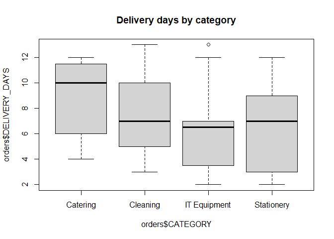<!-- -->

``` r
boxplot(data_class$HEIGHT ~ data_class$GENDER, data = data_class,
        main = "Height of students by gender")
```

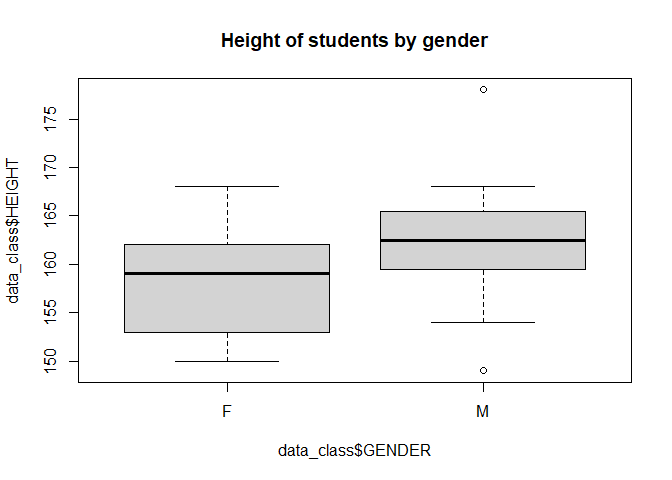<!-- -->

### Relationship between two categorical variables

Are some categories delivered late more often? An order is “Late” when
it takes more than 7 days.

``` r
orders$SPEED <- ifelse(orders$DELIVERY_DAYS > 7, "Late", "On time")
(cross <- xtabs(~ CATEGORY + SPEED, data = orders))
```

    ##               SPEED
    ## CATEGORY       Late On time
    ##   Catering        5       3
    ##   Cleaning        4       5
    ##   IT Equipment    2      10
    ##   Stationery      4       5

``` r
prop.table(cross, 1)
```

    ##               SPEED
    ## CATEGORY            Late   On time
    ##   Catering     0.6250000 0.3750000
    ##   Cleaning     0.4444444 0.5555556
    ##   IT Equipment 0.1666667 0.8333333
    ##   Stationery   0.4444444 0.5555556

### Simpson’s paradox

A trend that appears in combined data can disappear or reverse when the
data is broken into groups. To check for it, compare the relationship
for all students together with the relationship inside each gender.

``` r
cor(data_class$HEIGHT, data_class$WEIGHT)          # all students
```

    ## [1] 0.3870598

``` r
by(data_class, data_class$GENDER, function(d) cor(d$HEIGHT, d$WEIGHT))
```

    ## data_class$GENDER: F
    ## [1] 0.3587332
    ## ------------------------------------------------------------ 
    ## data_class$GENDER: M
    ## [1] 0.4036415

Here the positive relationship holds in both groups, so there is no
Simpson’s paradox in this data. Checking inside groups is still
important, because a combined result can hide the opposite pattern.

## Bar Chart

Spend per category (million RWF) in two quarters:

``` r
dat <- read.table(text = "Stationery IT Cleaning Catering
Q1 4.2 9.8 1.5 6.0
Q2 3.6 12.1 2.0 5.4", header = TRUE)
barplot(as.matrix(dat), beside = TRUE, col = c("Red", "green"),
        legend.text = rownames(dat), main = "Spend by category and quarter")
```

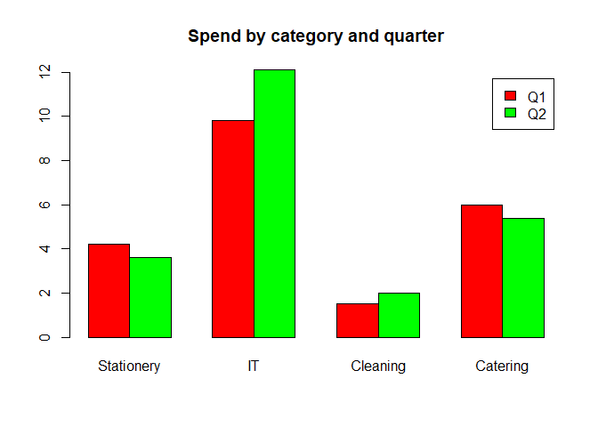<!-- -->

``` r
barplot(as.matrix(dat), main = "Spend by category (stacked)")
```

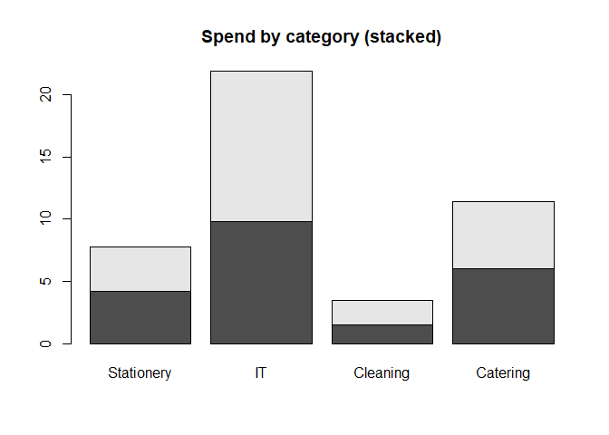<!-- -->

``` r
barplot(table(orders$CATEGORY), col = "steelblue", main = "Number of orders by category")
```

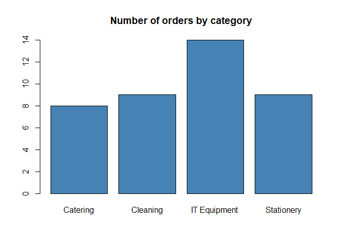<!-- -->

## Scatter Plot

``` r
plot(WEIGHT ~ HEIGHT, data = data_class)
```

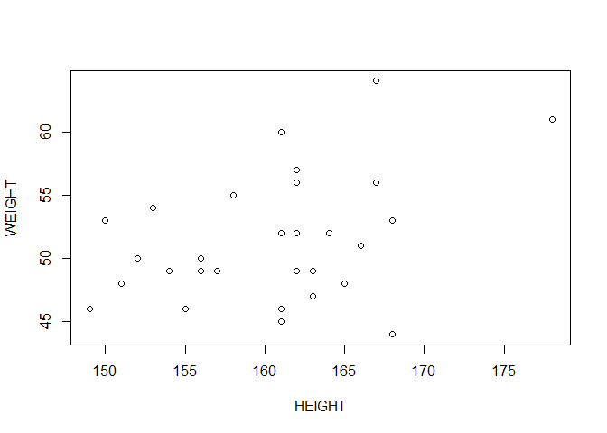<!-- -->

``` r
plot(data_class$HEIGHT, data_class$WEIGHT)
```

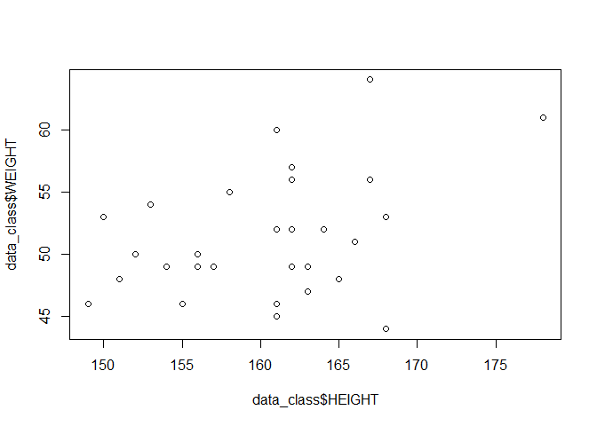<!-- -->

``` r
plot(data_class[, 3], data_class[, 4], main = "Graph")
```

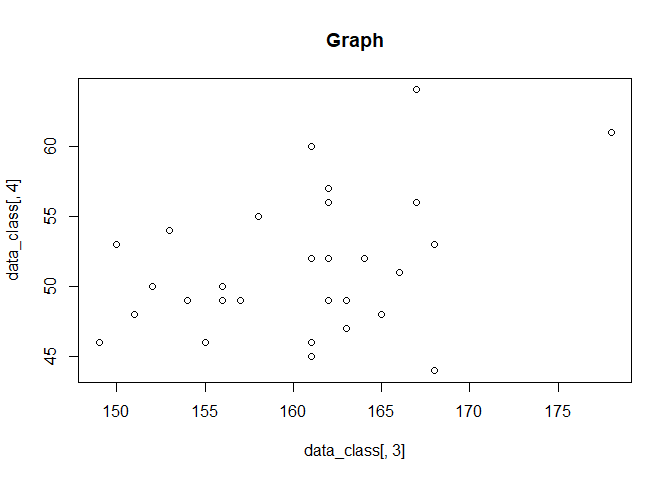<!-- -->

``` r
cor(data_class$HEIGHT, data_class$WEIGHT)
```

    ## [1] 0.3870598

## Linear Models

``` r
plot(WEIGHT ~ HEIGHT, data = data_class)
abline(lm(WEIGHT ~ HEIGHT, data = data_class)$coefficient)
```

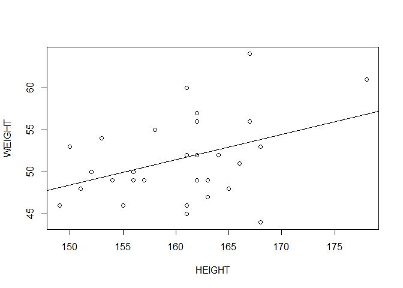<!-- -->

``` r
data_lm <- lm(HEIGHT ~ WEIGHT, data = data_class)
summary(data_lm)
```

    ## 
    ## Call:
    ## lm(formula = HEIGHT ~ WEIGHT, data = data_class)
    ## 
    ## Residuals:
    ##      Min       1Q   Median       3Q      Max 
    ## -11.1647  -3.6654  -0.1633   3.8283  12.8465 
    ## 
    ## Coefficients:
    ##             Estimate Std. Error t value Pr(>|t|)    
    ## (Intercept) 134.7390    11.6340  11.581 3.43e-12 ***
    ## WEIGHT        0.4986     0.2245   2.221   0.0346 *  
    ## ---
    ## Signif. codes:  0 '***' 0.001 '**' 0.01 '*' 0.05 '.' 0.1 ' ' 1
    ## 
    ## Residual standard error: 5.995 on 28 degrees of freedom
    ## Multiple R-squared:  0.1498, Adjusted R-squared:  0.1195 
    ## F-statistic: 4.934 on 1 and 28 DF,  p-value: 0.03459

``` r
par(mfrow = c(2, 2))
plot(data_lm)
```

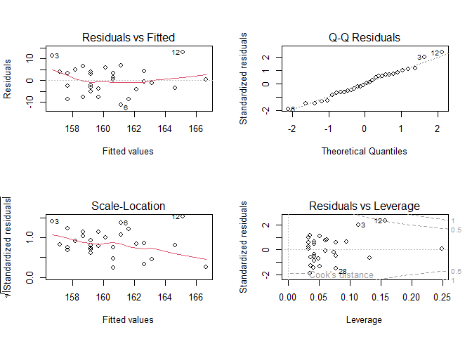<!-- -->

``` r
par(mfrow = c(1, 1))
```

``` r
hist(data_class$HEIGHT)
```

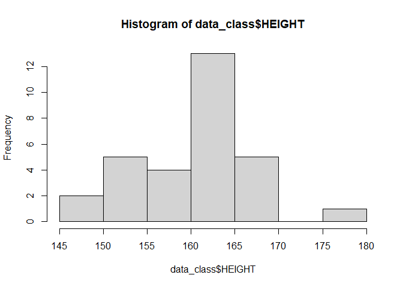<!-- -->

``` r
hist(data_class$WEIGHT, col = "blue")
```

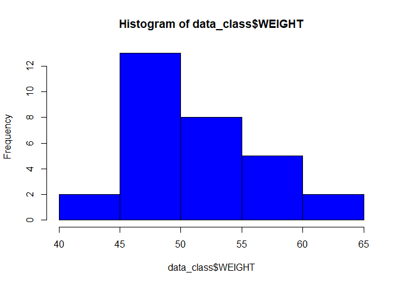<!-- -->

### Linear with other line

``` r
plot(WEIGHT ~ HEIGHT, data = data_class)
abline(lm(WEIGHT ~ HEIGHT, data = data_class)$coefficient)
lines(lowess(data_class$HEIGHT, data_class$WEIGHT), col = "blue")
```

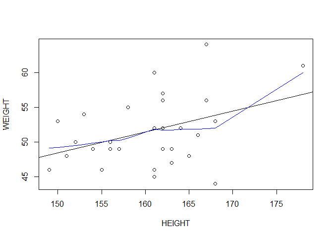<!-- -->

``` r
cor(data_class$HEIGHT, data_class$WEIGHT)
```

    ## [1] 0.3870598

``` r
lm(WEIGHT ~ HEIGHT, data = data_class)
```

    ## 
    ## Call:
    ## lm(formula = WEIGHT ~ HEIGHT, data = data_class)
    ## 
    ## Coefficients:
    ## (Intercept)       HEIGHT  
    ##      3.3841       0.3005

## Data management

### Create another variable

BMI of the students, and total cost of the purchase orders.

``` r
attach(data_class)
(BMI <- WEIGHT / (HEIGHT / 100)^2)
```

    ##  [1] 20.54569 19.81405 15.58957 21.33821 20.13478 23.55556 23.14726 18.50777
    ##  [9] 22.94812 20.06095 18.44255 19.25262 21.71925 17.74623 18.67093 23.06805
    ## [17] 18.77834 20.07960 19.14672 17.68979 17.36044 21.05171 20.66116 22.03173
    ## [25] 21.64127 21.71925 19.33373 20.71979 17.63085 19.87910

``` r
(BMI <- round(WEIGHT / (HEIGHT / 100)^2, digits = 2))
```

    ##  [1] 20.55 19.81 15.59 21.34 20.13 23.56 23.15 18.51 22.95 20.06 18.44 19.25
    ## [13] 21.72 17.75 18.67 23.07 18.78 20.08 19.15 17.69 17.36 21.05 20.66 22.03
    ## [25] 21.64 21.72 19.33 20.72 17.63 19.88

``` r
head(cbind(data_class, BMI), n = 5)
```

    ##   ID GENDER HEIGHT WEIGHT   BMI
    ## 1  1      M    156     50 20.55
    ## 2  2      M    162     52 19.81
    ## 3  3      M    168     44 15.59
    ## 4  4      F    162     56 21.34
    ## 5  5      F    156     49 20.13

``` r
new_data_class <- cbind(data_class, BMI)
tail(cbind(data_class, BMI), n = 10)
```

    ##    ID GENDER HEIGHT WEIGHT   BMI
    ## 21 21      F    161     45 17.36
    ## 22 22      F    151     48 21.05
    ## 23 23      M    154     49 20.66
    ## 24 24      M    158     55 22.03
    ## 25 25      F    152     50 21.64
    ## 26 26      F    162     57 21.72
    ## 27 27      M    164     52 19.33
    ## 28 28      M    149     46 20.72
    ## 29 29      M    165     48 17.63
    ## 30 30      F    157     49 19.88

``` r
detach(data_class)
```

``` r
orders$TOTAL_COST <- orders$QUANTITY * orders$UNIT_PRICE
head(orders[, c("PO_ID", "QUANTITY", "UNIT_PRICE", "TOTAL_COST")])
```

    ##   PO_ID QUANTITY UNIT_PRICE TOTAL_COST
    ## 1 PO001       98      42600    4174800
    ## 2 PO002       28      18900     529200
    ## 3 PO003       26      20600     535600
    ## 4 PO004       93      41400    3850200
    ## 5 PO005       80      44700    3576000
    ## 6 PO006       58      42100    2441800

### Summary of BMI

``` r
summary(BMI)
```

    ##    Min. 1st Qu.  Median    Mean 3rd Qu.    Max. 
    ##   15.59   18.70   20.07   20.08   21.57   23.56

``` r
stem(BMI, scale = 2)
```

    ## 
    ##   The decimal point is at the |
    ## 
    ##   15 | 6
    ##   16 | 
    ##   16 | 
    ##   17 | 4
    ##   17 | 678
    ##   18 | 4
    ##   18 | 578
    ##   19 | 233
    ##   19 | 89
    ##   20 | 111
    ##   20 | 677
    ##   21 | 13
    ##   21 | 677
    ##   22 | 0
    ##   22 | 
    ##   23 | 012
    ##   23 | 6

## Date

``` r
today <- Sys.Date()
format(today, format = "%B %d %Y")
```

    ## [1] "October 31 2026"

``` r
format(today, format = "%A")
```

    ## [1] "Saturday"

How long did an order take, and how many days until a contract ends?

``` r
order_date <- as.Date("2026-09-14")
delivery_date <- as.Date("2026-09-26")
delivery_date - order_date
```

    ## Time difference of 12 days

``` r
contract_end <- as.Date("2027-06-30")
difftime(contract_end, today, units = "days")
```

    ## Time difference of 242 days

``` r
difftime(contract_end, today, units = "weeks")
```

    ## Time difference of 34.57143 weeks

## Subsetting

Use of `$`, `[]` or `[[]]`.

Creation of supplier evaluation data. Interest: how suppliers in Kigali
and outside Kigali are rated by staff. Five questions were asked, for
example: does the supplier deliver on time? (1 strongly disagree, 2
disagree, 3 neither agree nor disagree, 4 agree, 5 strongly agree).
Years of partnership coded 99 means the value is missing.

``` r
supplier <- c(1, 2, 3, 4, 5)
location <- c("Kigali", "Kigali", "Musanze", "Huye", "Kigali")
type <- c("Goods", "Services", "Goods", "Goods", "Services")
years <- c(3, 8, 1, 6, 99)
q1 <- c(5, 3, 3, 3, 2)
q2 <- c(4, 5, 5, 3, 2)
q3 <- c(5, 2, 5, 4, 1)
q4 <- c(5, 5, 5, NA, 2)
q5 <- c(5, 5, 2, NA, 1)
evaluation <- data.frame(supplier, location, type, years, q1, q2, q3, q4, q5)
str(evaluation)
```

    ## 'data.frame':    5 obs. of  9 variables:
    ##  $ supplier: num  1 2 3 4 5
    ##  $ location: chr  "Kigali" "Kigali" "Musanze" "Huye" ...
    ##  $ type    : chr  "Goods" "Services" "Goods" "Goods" ...
    ##  $ years   : num  3 8 1 6 99
    ##  $ q1      : num  5 3 3 3 2
    ##  $ q2      : num  4 5 5 3 2
    ##  $ q3      : num  5 2 5 4 1
    ##  $ q4      : num  5 5 5 NA 2
    ##  $ q5      : num  5 5 2 NA 1

``` r
names(evaluation)
```

    ## [1] "supplier" "location" "type"     "years"    "q1"       "q2"       "q3"      
    ## [8] "q4"       "q5"

What can be done: combine the scores of the five questions, handle the
missing values, create a dataset of what we want, and create groups by
years of partnership.

### Missing value

``` r
evaluation$years[evaluation$years == 99] <- NA
evaluation$yearcat[evaluation$years > 5] <- "Long term"
evaluation$yearcat[evaluation$years >= 2 & evaluation$years <= 5] <- "Medium term"
evaluation$yearcat[evaluation$years < 2] <- "New"
evaluation$total_score <- evaluation$q1 + evaluation$q2 + evaluation$q3 + evaluation$q4 + evaluation$q5
evaluation
```

    ##   supplier location     type years q1 q2 q3 q4 q5     yearcat total_score
    ## 1        1   Kigali    Goods     3  5  4  5  5  5 Medium term          24
    ## 2        2   Kigali Services     8  3  5  2  5  5   Long term          20
    ## 3        3  Musanze    Goods     1  3  5  5  5  2         New          20
    ## 4        4     Huye    Goods     6  3  3  4 NA NA   Long term          NA
    ## 5        5   Kigali Services    NA  2  2  1  2  1        <NA>           8

### One way to handle missing values

Listwise deletion removes all observations with missing data. Missing
values can also be replaced by the average of the remaining data.

``` r
is.na(evaluation[, 5:9])
```

    ##         q1    q2    q3    q4    q5
    ## [1,] FALSE FALSE FALSE FALSE FALSE
    ## [2,] FALSE FALSE FALSE FALSE FALSE
    ## [3,] FALSE FALSE FALSE FALSE FALSE
    ## [4,] FALSE FALSE FALSE  TRUE  TRUE
    ## [5,] FALSE FALSE FALSE FALSE FALSE

``` r
newdata <- na.omit(evaluation)
newdata
```

    ##   supplier location     type years q1 q2 q3 q4 q5     yearcat total_score
    ## 1        1   Kigali    Goods     3  5  4  5  5  5 Medium term          24
    ## 2        2   Kigali Services     8  3  5  2  5  5   Long term          20
    ## 3        3  Musanze    Goods     1  3  5  5  5  2         New          20

Replacing missing delivery days in the orders by the average:

``` r
orders$DELIVERY_DAYS[is.na(orders$DELIVERY_DAYS)] <- round(mean(orders$DELIVERY_DAYS, na.rm = TRUE))
sum(is.na(orders$DELIVERY_DAYS))
```

    ## [1] 0

### Sorting data

``` r
order(evaluation$years)
```

    ## [1] 3 1 4 2 5

``` r
(newdata2 <- evaluation[order(evaluation$years), ])
```

    ##   supplier location     type years q1 q2 q3 q4 q5     yearcat total_score
    ## 3        3  Musanze    Goods     1  3  5  5  5  2         New          20
    ## 1        1   Kigali    Goods     3  5  4  5  5  5 Medium term          24
    ## 4        4     Huye    Goods     6  3  3  4 NA NA   Long term          NA
    ## 2        2   Kigali Services     8  3  5  2  5  5   Long term          20
    ## 5        5   Kigali Services    NA  2  2  1  2  1        <NA>           8

``` r
head(orders[order(orders$TOTAL_COST, decreasing = TRUE), c("PO_ID", "SUPPLIER", "TOTAL_COST")])
```

    ##    PO_ID               SUPPLIER TOTAL_COST
    ## 30 PO030 Kigali Office Supplies    4200800
    ## 1  PO001 Kigali Office Supplies    4174800
    ## 4  PO004        Rwanda Tech Ltd    3850200
    ## 5  PO005        Rwanda Tech Ltd    3576000
    ## 18 PO018        Rwanda Tech Ltd    3287900
    ## 19 PO019        Rwanda Tech Ltd    2863500

### Merging data sets

`merge()` joins two data frames horizontally by a common key variable.
Here the orders are joined with the supplier locations using the
supplier name.

``` r
supplier_info <- data.frame(SUPPLIER = c("Kigali Office Supplies", "Rwanda Tech Ltd",
                                         "Clean Plus", "Ubumwe Catering"),
                            LOCATION = c("Kigali", "Kigali", "Kigali", "Kigali"),
                            RATING = c(4.5, 4.0, 4.2, 3.8))
orders_full <- merge(orders, supplier_info, by = "SUPPLIER")
head(orders_full[, c("PO_ID", "SUPPLIER", "LOCATION", "RATING")])
```

    ##   PO_ID   SUPPLIER LOCATION RATING
    ## 1 PO009 Clean Plus   Kigali    4.2
    ## 2 PO006 Clean Plus   Kigali    4.2
    ## 3 PO015 Clean Plus   Kigali    4.2
    ## 4 PO017 Clean Plus   Kigali    4.2
    ## 5 PO022 Clean Plus   Kigali    4.2
    ## 6 PO032 Clean Plus   Kigali    4.2

`rbind()` joins two data frames vertically. They must have the same
variables.

``` r
new_supplier <- data.frame(SUPPLIER = "Huye Stationers", LOCATION = "Huye", RATING = 4.1)
rbind(supplier_info, new_supplier)
```

    ##                 SUPPLIER LOCATION RATING
    ## 1 Kigali Office Supplies   Kigali    4.5
    ## 2        Rwanda Tech Ltd   Kigali    4.0
    ## 3             Clean Plus   Kigali    4.2
    ## 4        Ubumwe Catering   Kigali    3.8
    ## 5        Huye Stationers     Huye    4.1

### Subset (selecting variables, dropping variables, selecting observations)

``` r
newdata3 <- evaluation[, c(5:9)]
myvars <- c("q1", "q2", "q3", "q4", "q5")
(newdata3 <- evaluation[myvars])
```

    ##   q1 q2 q3 q4 q5
    ## 1  5  4  5  5  5
    ## 2  3  5  2  5  5
    ## 3  3  5  5  5  2
    ## 4  3  3  4 NA NA
    ## 5  2  2  1  2  1

``` r
newdata4 <- evaluation[, c(-1, -2)]
(newdata4 <- evaluation[, -(1:5)])
```

    ##   q2 q3 q4 q5     yearcat total_score
    ## 1  4  5  5  5 Medium term          24
    ## 2  5  2  5  5   Long term          20
    ## 3  5  5  5  2         New          20
    ## 4  3  4 NA NA   Long term          NA
    ## 5  2  1  2  1        <NA>           8

``` r
newdata5 <- evaluation[, c(-1, -7)]
evaluation[[4]]
```

    ## [1]  3  8  1  6 NA

``` r
evaluation$years
```

    ## [1]  3  8  1  6 NA

``` r
newdata6 <- evaluation[c(-1, -3), ]
(newdata6 <- evaluation[c(2, 4, 5), ])
```

    ##   supplier location     type years q1 q2 q3 q4 q5   yearcat total_score
    ## 2        2   Kigali Services     8  3  5  2  5  5 Long term          20
    ## 4        4     Huye    Goods     6  3  3  4 NA NA Long term          NA
    ## 5        5   Kigali Services    NA  2  2  1  2  1      <NA>           8

``` r
(newdata7 <- subset(evaluation, years >= 5 | years < 2, select = c(q1, q2, q3, q4, q5)))
```

    ##   q1 q2 q3 q4 q5
    ## 2  3  5  2  5  5
    ## 3  3  5  5  5  2
    ## 4  3  3  4 NA NA

``` r
(newdata8 <- evaluation[evaluation$location == "Kigali" & evaluation$total_score > 15, ])
```

    ##   supplier location     type years q1 q2 q3 q4 q5     yearcat total_score
    ## 1        1   Kigali    Goods     3  5  4  5  5  5 Medium term          24
    ## 2        2   Kigali Services     8  3  5  2  5  5   Long term          20

Orders above 2 million RWF that took more than 7 days:

``` r
subset(orders, TOTAL_COST > 2000000 & DELIVERY_DAYS > 7,
       select = c(PO_ID, SUPPLIER, TOTAL_COST, DELIVERY_DAYS))
```

    ##    PO_ID        SUPPLIER TOTAL_COST DELIVERY_DAYS
    ## 7  PO007 Ubumwe Catering    2420000            11
    ## 9  PO009      Clean Plus    2653500            13
    ## 14 PO014      Clean Plus    2602600            10
